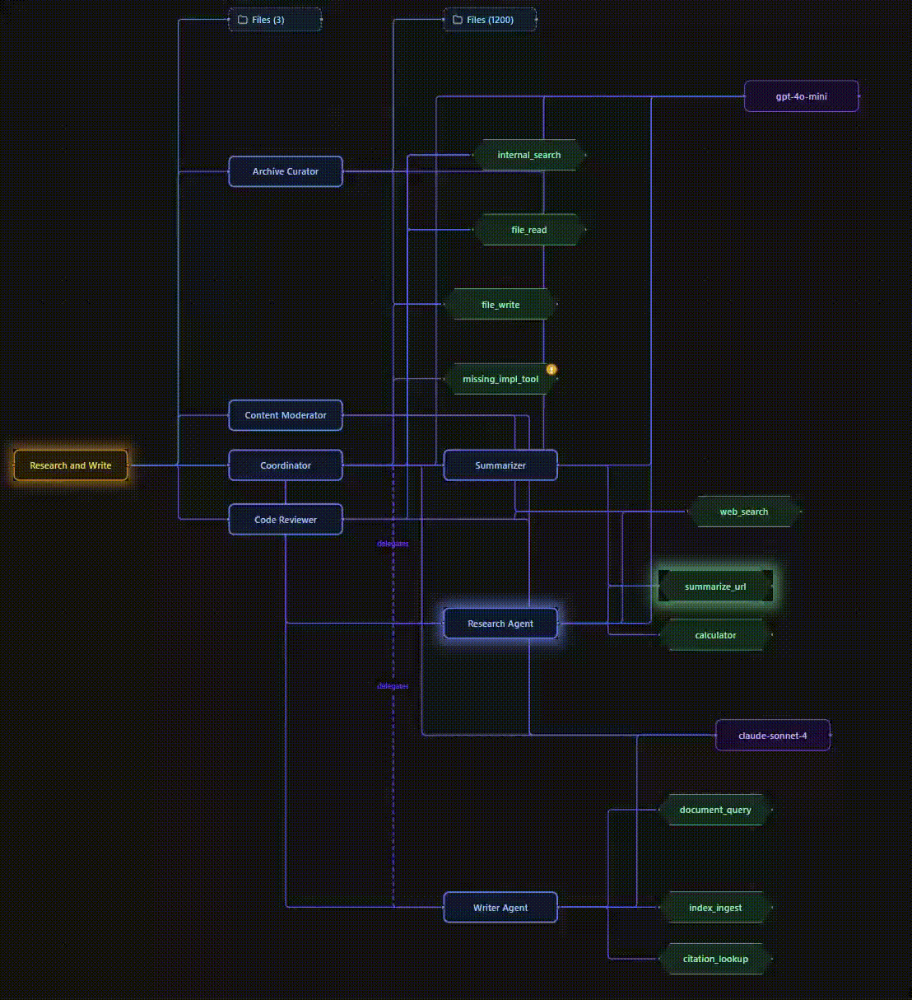
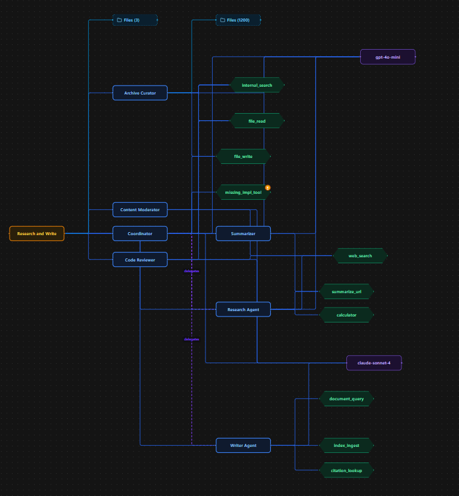
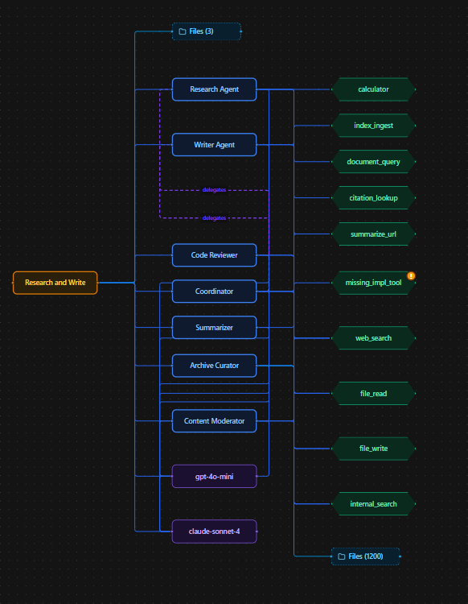
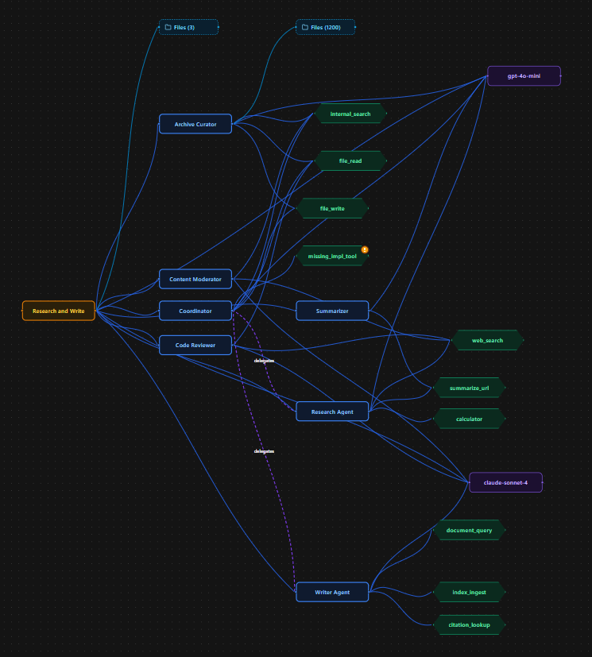

# Agentic Project Visualizer

A desktop app that draws the architecture of an agentic project as one interactive graph: workflows, agents, models, tools, the Python functions behind those tools, what those functions call, and the HTTP endpoints that expose them. It builds the picture from two places you already have, the database where your agents are defined and your source code, so nobody has to draw or maintain a diagram by hand.

If you want, it can also show the project running: nodes light up while a workflow, agent or tool is executing, and get a red ring when they fail.

No AI runs inside this app. It reads your database, parses your code, and draws. It never imports or executes your project.

<!-- Demo GIF: save it as docs/demo.gif and this line picks it up. -->


**Version 0.1.0 — early release.** It works end to end, but only for a specific kind of project (see [What's supported right now](#whats-supported-right-now)). Expect rough edges and breaking changes before 1.0.

---

## Contents

- [How it works](#how-it-works)
- [What's supported right now](#whats-supported-right-now)
- [Requirements](#requirements)
- [Installation](#installation)
- [Try it with the bundled example](#try-it-with-the-bundled-example)
- [Using it on your own project](#using-it-on-your-own-project)
- [Live tracing](#live-tracing)
- [Working with the graph](#working-with-the-graph)
- [Development](#development)
- [Troubleshooting](#troubleshooting)
- [Repository layout](#repository-layout)
- [Roadmap](#roadmap)

---

## How it works

The graph is built in layers. Each layer adds nodes and edges on top of the one before it:

| Layer | Reads | Adds |
|---|---|---|
| L1 | Your MongoDB collections | workflow, agent, tool, model and file nodes, plus the links between them (`agent_ids`, `tool_ids`, `model_id`, ...) |
| L2 | Your Python source | the function that implements each tool (`implements` edges) |
| L3 | Your Python source | which of your functions call which (`calls` edges) |
| L4 | Your Python source | FastAPI / Flask routes, linked to their handler functions (`exposes` edges) |

L1 needs only the database. L2–L4 run when you also give the app the folder your code lives in. The code is parsed with Python's `ast` module, never imported or run.

The live overlay is separate and optional. Your running program reports when each step starts and ends, the app matches those reports to nodes in the graph, and the nodes glow.

```
 your project                               the app
 ───────────────────────────                ───────────────────────────────────────────
 MongoDB  (workflows, agents, tools) ─────► L1  ┐
 source   (.py files)                ─────► L2–L4 ┴─► graph ──► desktop window
                                                         ▲
 running program ──► trace events ──► matched to nodes ──┘   (optional live overlay)
```

The desktop window is a Tauri app (React + TypeScript). It starts a local Python backend (FastAPI) on a random port on `127.0.0.1`, protected by a token that changes every launch. Nothing is sent anywhere; the only network connections are to the MongoDB you point it at.

---

## What's supported right now

This first release covers one kind of project well rather than many kinds badly. In short: **your workflows and agents have to be stored in MongoDB, and your code has to be Python.** More is coming (see [Roadmap](#roadmap)).

| | Supported now | Not yet |
|---|---|---|
| Where workflows and agents are defined | Records in **MongoDB** collections | Projects that define everything in code (LangGraph graphs, CrewAI crews, OpenAI Agents SDK, ...) |
| Database | **MongoDB** | Postgres, MySQL, SQLite, vector stores |
| Source code | **Python**, from a local folder | Other languages; GitHub URLs |
| Tool → function matching | LangChain `@tool`, LlamaIndex `FunctionTool.from_defaults(...)`, plain functions | Other frameworks' tool wrappers |
| Endpoints | **FastAPI** and **Flask** route decorators | Other web frameworks |
| Live tracing | **Live trace** (`apv_trace` helper) and **OpenTelemetry (OTLP/HTTP)** | More methods are planned |
| Platform | **Windows**, run from source | Installer; macOS |

---

## Requirements

Install these once:

- **Python 3.11+**
- **[uv](https://docs.astral.sh/uv/)**: `winget install astral-sh.uv`
- **Node.js 20+**
- **Rust**, from [rustup.rs](https://rustup.rs). On Windows, Tauri also needs the MSVC build tools:
  ```powershell
  winget install Microsoft.VisualStudio.2022.BuildTools --override "--wait --add Microsoft.VisualStudioComponent.VC.Tools.x86.x64"
  ```
- **MongoDB** that the app can reach. For the bundled example a local one is enough; if you don't want to install it:
  ```powershell
  docker run -d -p 27017:27017 --name apv-mongo mongo:7
  ```

`uv` must be on your `PATH`: the app uses it to start its backend.

---

## Installation

Commands are PowerShell. On macOS/Linux use `/` in paths and skip step 1.

```powershell
git clone https://github.com/Ra00f1/Agentic-Project-Visualizer.git
cd Agentic-Project-Visualizer

# 1. Allow npm scripts to run (Windows, once per machine)
Set-ExecutionPolicy -Scope CurrentUser -ExecutionPolicy RemoteSigned

# 2. Backend dependencies
cd apps\backend
uv sync
cd ..\..

# 3. Desktop app dependencies
cd apps\desktop
npm install
cd ..\..
```

Start the app:

```powershell
cd apps\desktop
npm run tauri dev
```

The first start takes 5–10 minutes (Rust compiles, and `uv` sets up the backend's Python environment). After that it opens in a few seconds. You'll land on the **Setup** screen.

---

## Try it with the bundled example

The repo ships with `mock-agent-project`, a fake agent system with a seeded MongoDB and a matching codebase. It's the quickest way to see what the app does.

**1. Seed the example database** (once):

```powershell
cd mock-agent-project
uv sync
uv run --with motor python mongo\seed.py --drop
cd ..
```

**2. Load it in the app.** Start the app (`npm run tauri dev` in `apps\desktop`) and on the Setup screen:

- MongoDB URI: `mongodb://localhost:27017`
- Database: `mock_agent`
- Collections: the screen lists them and pre-fills each one's role. The defaults are right for the example.
- Codebase root: the full path to `mock-agent-project` inside your clone, e.g. `C:\code\Agentic-Project-Visualizer\mock-agent-project`

Click **Continue**. You'll see the workflows; click one to open its agents, click an agent to see its tools and model, and so on.

**3. Watch it run (optional).** The example has a small control panel, the *simulator*, that fakes workflow runs and reports them to the app.

```powershell
cd mock-agent-project
# Maps names in the simulator to the real database ids, for exact matching.
# Re-run it whenever you reseed.
uv run python -m simulator.build_manifest --uri mongodb://localhost:27017 --db mock_agent
uv run python -m simulator.ui
```

In the app, go back to Setup, tick **Live trace (apv_trace)** under *Runtime tracing*, keep the default path and click **Continue**. Open a workflow in the graph, then press **Run** next to it in the simulator window. The workflow, each agent and each tool glow in order. Tick **Trigger error** before **Run** to see a failure: the failing nodes get a red ring, which clears the next time they run successfully.

There's also `runtime-demo-project`, an even smaller runnable example with no database behind it, used mainly to test the tracing pipeline. Its names don't match anything in `mock_agent`, so its events show up under **Dead letters** instead of lighting nodes. That's expected.

---

## Using it on your own project

### 1. Your database

The app expects your workflows, agents and tools to be documents in MongoDB, one collection per kind. Models, prompts and files are optional. A minimal shape that works:

```js
// workflows
{ "_id": ObjectId("..."), "name": "research_and_write", "display_name": "Research and Write",
  "agent_ids": [ObjectId("..."), ObjectId("...")] }

// agents
{ "_id": ObjectId("..."), "name": "research_agent", "display_name": "Research Agent",
  "model_id": ObjectId("..."), "tool_ids": [ObjectId("..."), ObjectId("...")] }

// tools
{ "_id": ObjectId("..."), "name": "web_search",
  "import_path": "src.tools.langchain_tools.web_search_tool" }

// models
{ "_id": ObjectId("..."), "name": "gpt-4o-mini", "provider": "openai" }
```

Field names don't have to match these exactly. On the Setup screen, each collection gets a row where you set:

- **Role:** workflow, agent, tool, model, prompt, user, file, or *other* (excluded). Workflow, agent and tool are required.
- **ID field:** usually `_id`.
- **Name field:** what's shown on the node. The app guesses (`display_name`, `name`, ...); change it if the guess is wrong.
- **Reference fields:** fields that hold ids of other records (`agent_ids`, `tool_ids`, `model_id`, ...). These become the edges.

Large collections that hang off a parent (a `files` collection with an `agent_id` on each document, for example) are loaded lazily: the parent shows a *Files (N)* node and the documents are fetched when you click it.

The mapping is remembered per database, so you only set it once.

### 2. Your code

Set **Codebase root** to the folder your Python imports are relative to. If a tool's `import_path` is `src.tools.search.web_search`, the codebase root is the folder that contains `src`.

- **Tool → function (L2):** each tool record needs to say where its function lives, either `import_path` (`package.module.function`) or `module_path` + `function_name`. LangChain `@tool`, LlamaIndex `FunctionTool.from_defaults(fn=...)` and plain functions are all recognized. If a tool points at something that doesn't exist, its node gets a small yellow ⚠.
- **Call graph (L3):** calls between your own functions, including through imports and simple class instances. Calls into libraries are left out.
- **Endpoints (L4):** FastAPI (`@app.get`, `@router.post`, ...) and Flask (`@app.route`, blueprints) routes become endpoint nodes connected to their handlers.

Leave the codebase root empty to get just the database layer.

### 3. Live tracing (optional)

See the next section.

---

## Live tracing

Live tracing is off until you turn it on. Pick one or more methods on the Setup screen under **Runtime tracing**. Your choice is saved and re-applied the next time you open the app.

| Method | What your project needs | What you see |
|---|---|---|
| **Live trace (apv_trace)** | The `apv_trace` helper from this repo, either launched through `apv-run` (no code changes) or with one call at startup | Nodes glow **while** the step is running |
| **OpenTelemetry (OTLP)** | A normal OpenTelemetry setup, pointed at the app with three environment variables | Nodes flash briefly **after** each step finishes |

Both can run at the same time; if a step is reported by both, it's counted once.

The **Runtime** chip next to the *Dead letters* button shows what's going on: *off*, *waiting for &lt;file&gt;*, *live · N events*, *error* (hover for details), or *disconnected*.

### Method 1: Live trace with `apv_trace`

`apv_trace` lives in `packages/apv_trace`. It isn't on PyPI yet, so install it from your clone into your project's environment:

```powershell
# from your project's folder
uv add --editable C:\path\to\Agentic-Project-Visualizer\packages\apv_trace
# or: pip install -e C:\path\to\Agentic-Project-Visualizer\packages\apv_trace
```

Then either of these:

**a) No code changes: run your program through `apv-run`.** It's installed with the package, so run it from your project's environment (with uv, prefix it with `uv run`):

```powershell
uv run apv-run -- python -m my_agents.main
uv run apv-run -- uvicorn my_agents.api:app
```

`apv-run` turns tracing on before your program starts and loads any [OpenInference](https://github.com/Arize-ai/openinference) instrumentors installed in your environment (e.g. `pip install openinference-instrumentation-langchain`), so LangChain/LlamaIndex agents, tools and LLM calls are reported automatically.

| Flag | What it does |
|---|---|
| `--log PATH` | Trace file to write (default: the shared `live.jsonl`, see below) |
| `--manifest PATH` | Name → database id file, for exact matching (see below) |
| `--functions [ROOT]` | Also report every function in your project under ROOT. Needs Python 3.12+ |
| `--max-calls N` | Stop reporting a function after N calls (default 10000), so hot loops don't flood the file |
| `--no-bridge` | Don't let a traced function also light up the tool that wraps it |
| `--oi-kinds MAP` | Change which OpenInference span kinds are used, e.g. `"CHAIN=workflow"` |
| `--disable a,b` / `--no-openinference` | Skip some or all OpenInference instrumentors |
| `--show-inputs` | Don't hide prompt/response content in OpenInference spans (hidden by default) |

**b) In code: one call at startup, plus markers where you want them.**

```python
import apv_trace
from apv_trace import trace

apv_trace.configure()                    # once, at startup

@trace(kind="workflow", name="Research and Write")
async def research_and_write(topic: str): ...

@trace(kind="agent", name="Research Agent")
async def research_agent(question: str): ...

@trace(kind="tool", name="web_search")
def web_search(query: str) -> list[str]: ...
```

`kind` is one of `workflow`, `agent`, `tool`, `function`, `model`. Use the same `name` your database uses for that record.

**Where the trace file goes.** By default `apv_trace` writes to one shared file, `%LOCALAPPDATA%\apv\apv\Logs\trace\live.jsonl` on Windows, which is also the default path on the Setup screen, so the two find each other without configuration. To use another file, set `APV_TRACE_LOG_PATH` in your program's environment (or `--log`) and put the same path in the Setup screen field.

**Exact matching with a manifest.** By default events are matched by name. To match by database id instead, give `apv_trace` a JSON file mapping `kind:name` to the record's `_id`:

```json
{
  "workflow:Research and Write": { "db_id": "500000000000000000000001" },
  "agent:Research Agent":        { "db_id": "400000000000000000000001" },
  "tool:web_search":             { "db_id": "300000000000000000000001" }
}
```

Pass it with `apv_trace.configure(manifest_path=Path("manifest.json"))` or `apv-run --manifest manifest.json`. `mock-agent-project/simulator/build_manifest.py` shows how to generate one from the database.

### Method 2: OpenTelemetry only (OTLP)

Use this if your project already uses OpenTelemetry, or you can't add packages to it. The app runs a small OTLP/HTTP receiver on `127.0.0.1` (port `4318` by default, changeable on the Setup screen). Tick **OpenTelemetry (OTLP)**, then set these in the terminal where your program runs:

```powershell
$env:OTEL_EXPORTER_OTLP_ENDPOINT = "http://127.0.0.1:4318"
$env:OTEL_EXPORTER_OTLP_PROTOCOL = "http/protobuf"
$env:OTEL_BSP_SCHEDULE_DELAY = "500"   # send every 0.5 s instead of every 5 s
```

OpenTelemetry only sends a span after it has finished, so with this method you see a short "just ran" flash after each step, about half a second to a few seconds late. You don't see it while it's running. That's a limit of OTLP, not something the app can work around.

The app recognizes these conventions. Any project using one of them is picked up without changes to the app:

**OpenInference** (what the LangChain / LlamaIndex instrumentors emit):

```python
from opentelemetry import trace
tracer = trace.get_tracer(__name__)

with tracer.start_as_current_span("pdf_read") as span:
    span.set_attribute("openinference.span.kind", "TOOL")      # or "AGENT", "LLM"
    span.set_attribute("tool.name", "pdf_read")                 # agent: "agent.name" / "graph.node.name"
    ...                                                         # LLM: "llm.model_name" / "llm.request.model_name"
```

Only `TOOL`, `AGENT` and `LLM` are used. Other kinds (`CHAIN`, `RETRIEVER`, ...) are ignored.

**OpenTelemetry GenAI conventions:**

```python
with tracer.start_as_current_span("execute_tool pdf_read") as span:
    span.set_attribute("gen_ai.operation.name", "execute_tool")   # or "invoke_agent", "create_agent", "chat", ...
    span.set_attribute("gen_ai.tool.name", "pdf_read")            # agent: "gen_ai.agent.name"; model: "gen_ai.request.model"
    ...
```

**Plain code attributes** (no agent/tool meaning, just "this function ran"). These only light up function nodes from the code layers, so you need a codebase root set:

```python
with tracer.start_as_current_span("PdfRead._run") as span:
    span.set_attribute("code.function.name", "agent_lab.tools.pdf_read.PdfRead._run")
    # older form: "code.namespace" = "agent_lab.tools.pdf_read.PdfRead", "code.function" = "_run"
```

**This app's own attributes** (`apv.kind`, `apv.name`, `apv.module`, `apv.qualname`) also work over OTLP. `runtime-demo-project/runtime_demo/run_demo_otel.py` is a full example.

The app never reads prompt or response content from spans (`input.value`, `output.value`, message attributes), only the names above.

### How events find their node, and why some don't

Recognizing what an event is (a tool, an agent, ...) is automatic. Finding *which* node it belongs to depends on names lining up. The app tries, in order:

1. the database id (from a manifest),
2. the module and function name, which also lights up the tool implemented by that function,
3. the tool's function path from its database record,
4. the name, matched against node names of the same kind,
5. for models, the model name with any version suffix removed (`claude-sonnet-4-20250514` → `claude-sonnet-4`).

If none of these match, the event goes to **Dead letters** (the button in the header) with the reason. A project whose span names differ from its database names will be recognized fine but end up there. Use a manifest, or name your spans the way your records are named.

---

## Working with the graph

- **Click** a node to open its children and focus it; everything else dims.
- **Double-click** an open node to collapse it.
- **Right-click** a node → **Inspect** opens a side panel with every field from the database or code, where it came from, and its live status. When the node has a known source location (tools, functions, endpoints), **Open in IDE** jumps to the line in VS Code.
- **/** focuses search, **f** fits the graph to the window, **Esc** clears focus, search and the side panel.
- **Compact / Tiered / Organic** switches the layout (see below).
- **Reset layout** throws away nodes you dragged.
- **Refresh** re-reads the database and code. Do this after changing either.

### Three layouts

<table>
  <tr>
    <td align="center" valign="top"><br><b>Compact</b></td>
    <td align="center" valign="top"><br><b>Tiered</b></td>
    <td align="center" valign="top"><br><b>Organic</b></td>
  </tr>
</table>

The same graph can be drawn three ways. The screenshots show the example's *Research and Write* workflow fully opened in each one. Pick one with the switch in the toolbar; the app remembers your choice.

- **Compact** packs nodes as tightly as it can. Best for getting a big graph onto one screen.
- **Tiered** lines nodes up in columns by how many steps they are from their workflow: workflows first, then their agents, then those agents' tools and models, and so on. Nodes stay in their column when you open more of the graph, so it's the easiest one to follow while exploring.
- **Organic** uses Compact's positions but draws the edges as curves, so lines that run side by side (one agent fanning out to many tools, say) don't merge into a single thick line.

---

## Development

**Backend with auto-reload.** `npm run tauri dev` starts its own backend. To edit backend code with `--reload`, start it yourself and point the app at it:

```powershell
# Terminal 1
cd apps\backend
$env:AGENTIC_SESSION_TOKEN = "dev-" + [guid]::NewGuid().ToString("N")
uv run uvicorn agentic_visualizer.main:app --port 8765 --reload

# Terminal 2
cd apps\desktop
$env:APV_DEV_BACKEND_URL = "http://127.0.0.1:8765"
$env:APV_DEV_SESSION_TOKEN = "<same value as Terminal 1>"
npm run tauri dev
```

**Turning tracing on without the Setup screen.** Set `AGENTIC_DEFAULT_TRACE_LOG_PATH` before `npm run tauri dev`. A choice saved on the Setup screen replaces it once you press Continue.

**Tests**, each from its own folder:

| Folder | Command | Note |
|---|---|---|
| `apps\backend` | `uv run pytest -v` | Some tests need the seeded `mock_agent` database |
| `packages\apv_trace` | `uv run pytest -v` | |
| `runtime-demo-project` | `uv run pytest -v` | |
| `apps\desktop` | `npm test` | |

**Logs.** The backend writes to `%LOCALAPPDATA%\com.agentic-visualizer.desktop\logs\backend.log`; the previous run is kept as `backend.prev.log`.

---

## Troubleshooting

**Stuck on "Starting backend…" or an error panel instead of the Setup screen.** Check `backend.log` (path above). Most often `uv` isn't on `PATH`, or the very first start is still setting up Python.

**Setup says MongoDB isn't reachable.** Start it: `Start-Service MongoDB`, or `docker start apv-mongo`.

**`npm : ... running scripts is disabled on this system`.** Run `Set-ExecutionPolicy -Scope CurrentUser -ExecutionPolicy RemoteSigned`.

**Rust fails to compile on the first run.** Usually the MSVC build tools are missing (see [Requirements](#requirements)).

**A tool has a yellow ⚠.** Its database record points at a function the code scanner couldn't find. Check `import_path`, and that the codebase root is the folder the import path starts from.

**Nothing lights up when my program runs.** Look at the **Runtime** chip first:
- *off*: no method is ticked on the Setup screen.
- *waiting for &lt;file&gt;*: your program hasn't written to that file. Check it uses the same path (`APV_TRACE_LOG_PATH`).
- *live* and the count goes up, but nothing glows: events arrive but don't match. Open **Dead letters** to see why. Make sure the node is visible (open its parent), and that the graph was refreshed after any database change.
- *error*: hover it. For OTLP this is usually the port already being in use.

**The simulator says "No manifest.json found".** Run `uv run python -m simulator.build_manifest --uri mongodb://localhost:27017 --db mock_agent` in `mock-agent-project`, and again after every reseed.

**"Open in IDE" does nothing.** Windows asks once whether to allow `vscode://` links; allow it. VS Code may ask whether to trust the link too.

---

## Repository layout

```
apps/
  backend/               Python backend: FastAPI, scanners (L1–L4), live tracing receiver
  desktop/               Desktop app: Tauri 2, React, TypeScript
packages/
  apv_trace/             Tracing helper you add to a project for live tracing (incl. apv-run)
  shared-types/          TypeScript types shared with the backend
mock-agent-project/      Example agent system: MongoDB seed, codebase, simulator
runtime-demo-project/    Tiny runnable example for the tracing pipeline
docs/                    README images; schemas/ holds the JSON schema of the trace event format
```

---

## Known limitations

- Workflows and agents must be stored in MongoDB. Code-only projects aren't supported yet.
- MongoDB is the only database.
- Only Python code is scanned, and only from a local folder.
- The saved collection mapping is stored in the app's local storage under a key that contains the MongoDB connection string, including any password in it. Until that's fixed, use a local or read-only database user.
- Windows is the only tested platform, and there's no installer yet: run it from source.
- The OTLP receiver accepts reports from any program on the same machine. It can only affect what the overlay shows.

---

## Roadmap

Planned, roughly in this order:

- More databases: Postgres, MySQL, SQLite, and vector stores.
- Projects defined in code: LangGraph, CrewAI, OpenAI Agents SDK, and plain Python, without needing a database.
- More live-tracing methods.
- Reading code straight from a GitHub URL.
- A Windows installer, then macOS.

---

## License

MIT — see [LICENSE](LICENSE).
